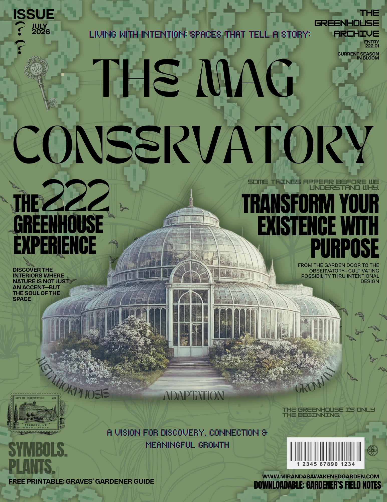

# M.A.G. Conservatory

This is the public homepage for what I’m developing within the [YOUR STU ecosystem](https://github.com/magraves222/YOUR-STU). I’m Miranda A. Graves, and this is where I share work from my notebooks, creative experiments, and projects in development.

## July 2026 · First Edition

- [Title page](exhibits/july-2026/title-page.webp)
- [Month overview](exhibits/july-2026/month-overview.webp)
- [Table of contents design](exhibits/july-2026/contents.webp)
- [The Metamorphosis Letter](exhibits/july-2026/metamorphosis-letter.webp)

## Research

### South Carolina’s ‘Use Cases’ of Emerging Technologies: Blockchain, AI & Robotics

I researched and wrote this paper at Charleston School of Law in 2023, when the generative AI boom was just getting underway. I looked at how South Carolina agencies could use blockchain, AI, and robotics, and what legal and practical questions those uses would raise.

[Read the full paper (PDF)](FINAL.pdf)
